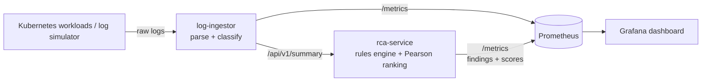

# CloudNetSleuth

Cloud-native **network observability and root-cause-analysis (RCA)** platform. Containerized Python
microservices ingest and parse logs from Kubernetes workloads, a rules-based RCA engine detects recurring
failure patterns (network timeouts, service disruptions, DNS/connection failures, OOM kills, ...) and returns
diagnostic recommendations, and Prometheus + Grafana visualize error trends, service health and RCA results.

## Architecture



| Service | Port | Responsibility |
|---|---|---|
| [`log-ingestor`](services/log-ingestor) | 8081 | Parses JSON/plain logs, classifies failure categories, keeps a sliding window, exports `cns_log_events_total` |
| [`rca-service`](services/rca-service) | 8080 | YAML rules engine ([rules](services/rca-service/app/service/rules/default_rules.yaml)) + Pearson-correlation ranking; `GET /api/v1/diagnose`; publishes findings as Prometheus gauges |
| [`log-simulator`](services/log-simulator) | - | Emits healthy traffic plus a recurring `db` timeout fault that cascades to `orders` and `gateway` |
| Prometheus / Grafana | 9090 / 3000 | Scrape config and a provisioned dashboard in [`deploy/`](deploy) |

Design: clean-architecture layers per service (`api`, `service`, `repository`, `models`, `config`), dependency
injection via FastAPI, structured JSON logging, `/health` + `/metrics` on every service, non-root multi-stage images.

## Quickstart (one command)

Requires Docker with Compose.

```bash
make demo          # or: docker compose up -d --build
```

- Grafana dashboard: <http://localhost:3000> (anonymous viewer; admin password from `GRAFANA_ADMIN_PASSWORD`, default `admin` - local demo only)
- Prometheus: <http://localhost:9090>
- RCA API docs: <http://localhost:8080/docs>, ingestor API docs: <http://localhost:8081/docs>

The simulator injects a database timeout fault for 40s out of every 90s. Within ~10s the dashboard shows
timeout events rising, `recurring_network_timeouts` firing for `db`, and `db` ranked as the top suspected cause.

```bash
curl -s localhost:8080/api/v1/diagnose | python -m json.tool   # live diagnosis
make down                                                       # stop and clean up
```

Example finding:

```json
{"rule": "recurring_network_timeouts", "service": "db", "severity": "critical",
 "recommendation": "Check network path and dependency health: inspect NetworkPolicies, kube-proxy/CNI status ..."}
```

## Tests

```bash
make test          # pytest for all three services (Python 3.11+)
```

CI runs the same on every push/PR ([workflow](.github/workflows/ci.yml)) and builds the images.

## Kubernetes

```bash
docker build -t cloudnetsleuth/log-ingestor:latest services/log-ingestor
docker build -t cloudnetsleuth/rca-service:latest services/rca-service
docker build -t cloudnetsleuth/log-simulator:latest services/log-simulator
# (kind/minikube: load the images into the cluster first)
kubectl create configmap grafana-datasources --from-file=deploy/grafana/provisioning/datasources
kubectl create configmap grafana-dashboard-providers --from-file=deploy/grafana/provisioning/dashboards
kubectl create configmap grafana-dashboards --from-file=deploy/grafana/dashboards
kubectl apply -f services/log-ingestor/k8s -f services/rca-service/k8s -f services/log-simulator/k8s -f deploy/k8s
kubectl port-forward svc/grafana 3000:3000
```

Note: the Grafana datasource points at `http://prometheus:9090`, which resolves to the in-cluster Service.
Set `RCA_INGESTOR_URL=http://log-ingestor:8081` and `RCA_POLL_INTERVAL_SECONDS` on the RCA deployment (already in its manifest).

## Roadmap

Distributed tracing (OpenTelemetry), event-driven anomaly pipeline, correlation graph engine, topology
auto-discovery, adaptive thresholding.
